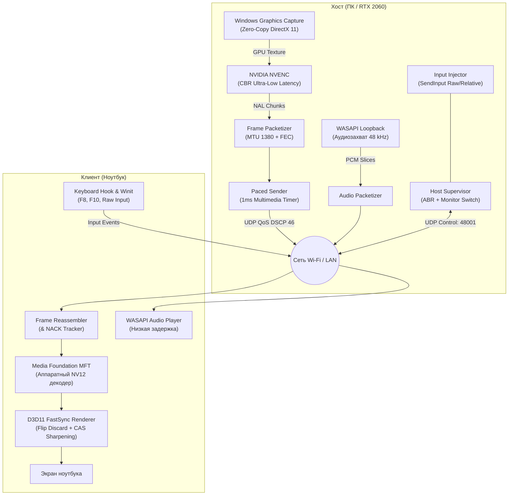

# ⚡ Remote-Ward

<div align="center">


**Сверхбыстрый, легковесный протокол и приложение удаленного рабочего стола для Windows с ультранизкой задержкой (Ultra-Low Latency).**  
Создан на базе **Rust**, **Direct3D 11**, аппаратного кодирования **NVIDIA NVENC** и кастомного **UDP-транспорта с упреждающей коррекцией ошибок (FEC)**.

[Особенности](#-основные-возможности) • [Архитектура](#-архитектура-системы) • [Сравнение с RDP](#-сравнение-с-microsoft-rdp) • [Горячие клавиши](#-управление-и-горячие-клавиши) • [Быстрый старт](#-быстрый-старт) • [Структура проекта](#-структура-проекта)

</div>

---

## 🚀 Основные возможности

* **🏎️ Ультранизкая задержка (< 10–15 мс сквозной инпут-лаг):**
  * Сетевой RTT в локальной сети: **2–4 мс**.
  * Аппаратное кодирование NVENC: **1.5–2.0 мс**.
  * Аппаратный декодер MFT: **1.0–1.5 мс**.
* **🎮 Гейминг и 3D-графика без компромиссов:**
  * Прямой захват физической видеокарты хоста (NVIDIA GeForce RTX) через **Windows Graphics Capture (WGC)** без блокировки мониторов.
  * Поддержка **Raw Input / Relative Mouse** — плавный поворот камеры на 360° в шутерах и 3D-редакторах (Blender, Unreal Engine).
* **🖥️ Аппаратный рендерер D3D11 с FastSync & CAS:**
  * Вывод кадров через **Flip Discard SwapChain** с флагом `ALLOW_TEARING` — мгновенная отрисовка в обход задержек композитора Windows DWM.
  * **Contrast Adaptive Sharpening (CAS)** в пиксельном HLSL-шейдере — мелкий системный текст и шрифты остаются кристально четкими даже при даунскейле с 1440p (QHD) на 1080p (FHD) экран ноутбука.
* **🌐 Надежный кастомный UDP-транспорт:**
  * **Упреждающее восстановление пакетов (Reed-Solomon FEC):** автоматическое восстановление утерянных пакетов на лету без ожидания сервера.
  * **Селективный NACK Retransmit:** дозапрос потерянных фрагментов за 2–3 мс.
  * **Микросекундный пейсер (PacedSender):** устранение микро-всплесков трафика (micro-bursts) и буферблоата роутеров.
  * **Wi-Fi QoS (DSCP 46 / Expedited Forwarding):** пакеты видеопотока маркируются наивысшим приоритетом для аппаратных очередей роутера (WMM Voice/Video).
* **🔊 Трансляция звука в реальном времени:**
  * Захват системного аудио хоста через **WASAPI Loopback** (48 кГц, стерео, 32-bit float) и воспроизведение через **WASAPI Shared Render** с нулевым рассинхроном звука и картинки.
* **⚡ Динамическое переключение мониторов (F8):**
  * Мгновенное переключение активного экрана хоста на лету с авто-согласованием габаритов экрана и самовосстановлением аппаратного декодера.
* **⌨️ Глубокий перехват системных клавиш:**
  * Низкоуровневый хук `WH_KEYBOARD_LL`: перехват клавиш Windows, Alt+Tab, Ctrl+Esc без реакции локальной ОС ноутбука.
  * Комбинация `Ctrl+Alt+End` для вызова меню безопасности Windows (**Ctrl+Alt+Del**) на удаленном ПК.
* **🌍 STUN NAT Traversal (RFC 5389):**
  * Встроенная поддержка определения публичного IP-адреса и типа NAT через серверы Google и Cloudflare для будущей игры вне дома.

---

## 🏛️ Архитектура системы



---

## 📊 Сравнение с Microsoft RDP

| Параметр | Microsoft RDP | Remote-Ward |
| :--- | :--- | :--- |
| **Сценарий использования** | Серверное администрирование, 1С, офис | **Игры, 3D (Blender/Unreal), видео, работа** |
| **Доступ к физическому GPU** | ❌ Виртуальный видеодрайвер (без DirectX/Vulkan) | **✅ Прямой доступ к RTX 2060 (нативная мощность)** |
| **Экран хоста при сессии** | ❌ Принудительно блокируется (Lock Screen) | **✅ Работает вживую, переключение мониторов (F8)** |
| **Сетевой протокол** | TCP (зависает при потере пакета по Wi-Fi) | **UDP + Reed-Solomon FEC + NACK + Pacer** |
| **Сквозная задержка ввода** | 60–150+ мс (плавающий курсор) | **10–15 мс (ощущение работы за локальным ПК)** |
| **Частота кадров** | 30 FPS (редко 60 FPS при твиках) | **60–120 FPS с субмиллисекундным выводом** |
| **Управление мышью в играх** | ❌ Курсор упирается в края экрана | **✅ Raw Input / Relative Mouse для вращения камеры** |

---

## ⌨️ Управление и горячие клавиши

| Сочетание | Назначение |
| :--- | :--- |
| <kbd>F8</kbd> | **Циклическое переключение монитора хоста** (монитор #0 ➔ монитор #1 ➔ ...) |
| <kbd>F10</kbd> | **Локальный аппаратный курсор** (0 мс задержки мыши) / Удаленный курсор |
| <kbd>F11</kbd> | **Полноэкранный режим** (Borderless Fullscreen) + Захват курсора в окно |
| <kbd>Ctrl</kbd> + <kbd>Alt</kbd> + <kbd>End</kbd> | Отправка сочетания **Ctrl + Alt + Del** на удаленный хост |
| <kbd>Alt</kbd> + <kbd>Tab</kbd> | Переключение окон на удаленном хосте (благодаря низкоуровневому хуку) |
| <kbd>Win</kbd> | Открытие меню «Пуск» на удаленном хосте |

---

## 📦 Структура проекта

Проект организован в виде модульного Rust-воркспейса из 7 независимых крейтов:

```text
remote-ward/
├── Cargo.toml                    # Корневой манифест воркспейса и LTO-профили
├── launcher.bat                  # Единый скрипт быстрого запуска приложения (Клиент / Хост)
└── crates/
    ├── core-protocol/            # Бинарный протокол датаграмм, управление, ввод, сериализация
    ├── core-transport/           # Сетевой транспорт: UDP, FEC, NACK, Pacer, STUN, сокеты
    ├── host-capture/             # Захват экрана Windows Graphics Capture (WGC) и DXGI
    ├── host-encode/              # Аппаратное кодирование NVIDIA NVENC (DirectX 11 Zero-Copy)
    ├── host-input/               # Низкоуровневая эмуляция клавиатуры/мыши (SendInput, RawInput)
    ├── host-server/              # Главный хост-демон, супервизор ABR, захват звука WASAPI
    └── client-app/               # Клиентское приложение: Winit GUI, D3D11 рендерер, MFT декодер
```

---

## 🛠️ Быстрый старт

### Требования
* **Хост:** Windows 10/11, видеокарта NVIDIA (серии GTX 9xx, GTX 16xx, RTX 20xx/30xx/40xx) с установленным драйвером NVIDIA.
* **Клиент:** Windows 10/11 (любой процессор Intel/AMD с поддержкой аппаратного декодирования H.264/HEVC).
* **Сборка:** [Rust Toolchain](https://rustup.rs/) (MSVC ABI).

### Быстрый запуск
Запустите единый скрипт на обоих устройствах:
```cmd
launcher.bat
```
* **На хосте (ПК):** перейдите на вкладку **«ХОСТ-СЕРВЕР»** и нажмите зеленую кнопку **«ЗАПУСТИТЬ ХОСТ-СЕРВЕР»**.
* **На клиенте (ноутбуке):** лаунчер автоматически обнаружит хост в домашней сети через LAN Discovery. Нажмите **«Стримить»** (или введите IP вручную и нажмите **«Подключиться»**).

### Ручной запуск через Cargo

* **Единый лаунчер:**
  ```bash
  cargo run --release -p client-app
  ```

---

## 🧪 Тестирование

Все компоненты покрыты автоматическими тестами (сетевой протокол, фрагментация, кодирование FEC, расчет задержек, конвертация NV12, сопоставление скан-кодов):

```bash
cargo test --workspace
```
> ✅ **35/35 тестов пройдены успешно.**

---

## 🗺️ Дорожная карта (Roadmap)

- [x] Аппаратный Zero-Copy захват экрана WGC (Windows Graphics Capture).
- [x] Аппаратное кодирование NVIDIA NVENC с CBR Ultra-Low Latency.
- [x] Аппаратный рендерер Direct3D 11 FastSync Flip Discard с ALLOW_TEARING.
- [x] Адаптивное увеличение резкости текста (CAS) при даунскейле с 1440p на 1080p.
- [x] Передача стереозвука без задержки (WASAPI Loopback -> WASAPI Player).
- [x] Локальный аппаратный курсор с 0 мс лага (F10) и относительный захват мыши (Raw Input).
- [x] Многомониторное переключение на лету (F8) с авто-восстановлением MFT декодера.
- [x] Кастомный протокол UDP с Reed-Solomon FEC, NACK и пейсингом пакетов.
- [x] Автоматическая калибровка сети и адаптивный битрейт (ABR).
- [x] Современный графический интерфейс (GUI Launcher) для подключения и запуска хоста в один клик без командной строки.
- [ ] Опциональное сквозное шифрование сессии (DTLS / ChaCha20-Poly1305).
- [ ] Виртуальный драйвер дисплея (IddCx) для работы хоста с полностью выключенными физическими мониторами.

---

<div align="center">
Разработано с ❤️ на чистом Rust для бескомпромиссной производительности.
</div>
